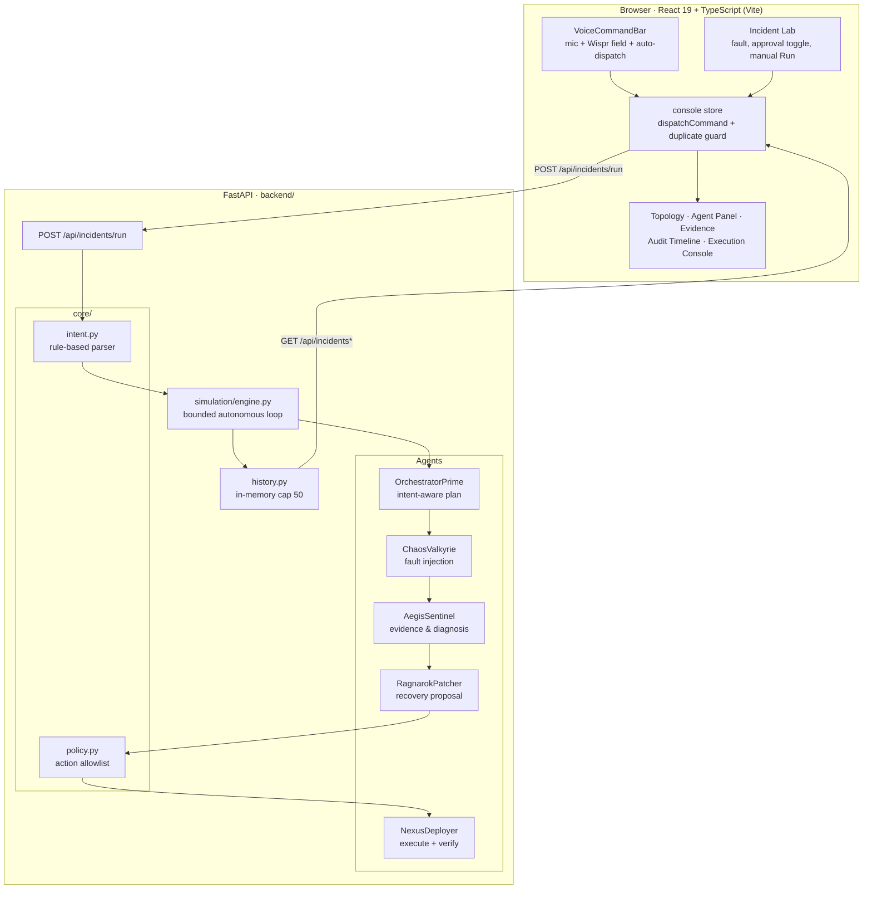
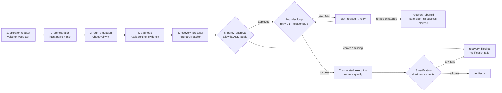
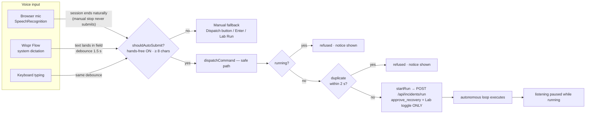

# Ragnarok AI — Voice-First Infrastructure Resilience Agent

> **Speak an incident. Watch an autonomous agent plan it, respect the safety gate, execute a simulated recovery, and prove the outcome with evidence — hands-free.**


Ragnarok AI is a **simulation-only** incident-response console where a spoken, natural-language request becomes a complete autonomous workflow: intent interpretation → intent-aware planning → bounded agent loop → **independent human approval gate** → simulated execution → evidence-based verification → full audit trail. It never connects to real infrastructure, and **voice can never grant approval**.

---

## Table of Contents

- [The Problem](#the-problem)
- [Vision & Unique Value](#vision--unique-value)
- [Feature Highlights](#feature-highlights)
- [Architecture](#architecture)
- [Autonomous Incident Lifecycle](#autonomous-incident-lifecycle)
- [Voice-First Workflow](#voice-first-workflow)
- [Safety Architecture](#safety-architecture)
- [Technology Stack](#technology-stack)
- [Getting Started (Windows / PowerShell)](#getting-started-windows--powershell)
- [API Reference](#api-reference)
- [Testing](#testing)
- [Demo Scenarios](#demo-scenarios)
- [Screenshots](#screenshots)
- [Limitations](#limitations)
- [Security Considerations](#security-considerations)
- [Roadmap (Planned — Not Implemented)](#roadmap-planned--not-implemented)
- [Contributing](#contributing)

---

## The Problem

Incident response today is fragmented: alerts arrive in one tool, context lives in another, the "fix" is a chat thread, and the actual authorization to act is an untracked tap on a phone. Operators retype the same context across dashboards, decisions are hard to reconstruct after the fact, and automation tools either demand clicks for every step or — worse — act without a verifiable approval record.

Teams that want to *prototype* autonomous operations need a safe place to see the whole loop: **understand → plan → act → verify → prove**, with a human gate in the middle. Real infrastructure is the wrong classroom.

## Vision & Unique Value

**Vision:** an operations console you can *talk to* — where a single spoken sentence drives a complete, auditable, safety-bounded response, and where every claim the system makes is backed by evidence in the response payload.

What makes Ragnarok AI distinctive:

| Differentiator | How it is implemented |
|---|---|
| **Voice in, autonomy out** | Browser `SpeechRecognition` **and** Wispr Flow dictation feed the same command bar; a completed command auto-dispatches the run with **zero clicks** (hands-free on by default) |
| **Voice is data, never authority** | The intent parser has no approval field; `approve_recovery` comes only from the explicit Incident Lab toggle — enforced by tests |
| **Bounded autonomy** | Max 3 loop iterations, 1 retry per step, 2-second budget → deterministic failure modes demo **retry** and **safe abort** |
| **Evidence-based truth** | 4 verification checks must all pass before `verified: true`; blocked or aborted runs never claim success |
| **Complete audit story** | `intent_parsed`, `plan_created`, `plan_revised`, `step_failed`, `policy_decision`, `recovery_blocked`, `run_aborted`, `verification` events, seq-numbered |
| **Simulation-only by construction** | In-memory state only, no outbound network calls, `simulation_only: true` on every event (test-enforced) |

---

## Feature Highlights

Status reflects the repository as it exists today.

| Status | Feature |
|:---:|---|
| ✅ | **Global Voice Command bar** — mic + plain text field, `aria-live` status, accessible controls, cyan listening indicator |
| ✅ | **Hands-free auto-dispatch (default ON)** — browser recognition completion *or* Wispr Flow text → debounced (1.5 s) submission through the safe dispatch path |
| ✅ | **Duplicate-submission protection** — trim-aware 2 s window, `running`-state refusal (unit-tested) |
| ✅ | **Listening pauses during execution** — mic disables while a run is in flight |
| ✅ | **Rule-based intent parser** — service, fault hint, constraints (`read_only`, `no_restart`, `no_deploy`), urgency; shapes plan, proposal and execution |
| ✅ | **Intent-aware planning** — `OrchestratorPrime.create_plan()` narrows to observation-only when the operator forbids changes |
| ✅ | **Bounded agent loop** — inspect → revise once → retry once → abort safely (`MAX_ITERATIONS=3`, `MAX_RETRIES_PER_STEP=1`, `LOOP_BUDGET_SECONDS=2.0`) |
| ✅ | **Independent policy gate** — allowlist (`core.policy`) ∧ explicit operator toggle; denial blocks execution with `recovery_blocked` |
| ✅ | **Simulation-only execution** — in-memory health flag only; no real infrastructure is contacted |
| ✅ | **Evidence-based verification** — `service_healthy`, `recovery_executed`, `expected_fault_resolved`, `operator_constraints_honored` |
| ✅ | **Incident history** — in-memory, cap 50, newest-first API order |
| ✅ | **Six-route dashboard** — Overview, Agents, Incident Lab, Evidence, Audit, Settings (hash routing) |
| ✅ | **Deterministic failure demo** — `simulate_failure: "once" \| "always"` exercises retry and safe-abort paths |
| ✅ | **API surface** — 6 endpoints incl. additive `POST /api/intents/parse` |
| ✅ | **Tests** — 35 backend (pytest) + 31 frontend (vitest) |
| ⬜ | Live event stream (SSE/WebSocket) — *planned, see [Roadmap](#roadmap-planned--not-implemented)* |
| ⬜ | Persistent storage — *planned* |
| ⬜ | Per-fault differentiated simulation behaviour — *planned* |
| ⬜ | Server-side speech-to-text — *intentionally out of scope; the API receives text only* |

---

## Architecture



**Clean architecture notes**

- `backend/core/` — pure domain logic (intent parsing, policy allowlist): no FastAPI imports, directly unit-tested.
- `backend/agents/` — five single-responsibility simulated agents; every mutation is appended to `incident.events`.
- `backend/simulation/` — orchestration engine + in-memory history (thread-locked).
- `frontend/src/lib/` — pure, testable logic (`dispatch`, `intent`, `lifecycle`, `speech`) separated from React components.
- `frontend/src/store/console.tsx` — single source of truth for config, runs, history and the safe dispatch entry point.

---

## Autonomous Incident Lifecycle

Eight stages — the exact contract returned by `GET /api/lifecycle` and rendered on the topology:



Every arrow is represented in the response payload: stage measurements in `.stages[]`, decisions in `.events[]` (seq-numbered), loop state in `.loop`, and the verdict in `.verification.checks[]`.

---

## Voice-First Workflow

Two input paths converge on **one safe dispatch function**:



**Wispr Flow compatibility:** the command bar is a plain controlled `<input>` — no `keydown` interception, no contenteditable, no focus stealing — so system-wide dictation lands in it natively. Hold your Wispr hotkey, speak, and the 1.5 s debounce dispatches the run.

**Browser mic:** supported in Chromium/Edge/Safari (desktop Firefox has no `SpeechRecognition`). Recognition runs client-side; the API receives **text only**.

**Approval is never in the voice path:** a spoken "approve recovery" with the Lab toggle OFF still produces `approved: false` — verified by `test_voice_submission_never_grants_policy_approval`.

---

## Safety Architecture

| Layer | Mechanism | Evidence in code |
|---|---|---|
| **Human approval gate** | `approve ∧ policy_allowlist`; voice/typed text has no approval field | `engine.py` policy stage; `policy.py` |
| **Simulation-only** | In-memory state, no outbound calls, `simulation_only: true` on every event | `test_simulation_does_not_claim_real_infrastructure` |
| **Bounded retries** | ≤ 1 retry/step, ≤ 3 iterations, 2 s budget | `engine.py` constants |
| **Safe abort** | `recovery_aborted` + `run_aborted` event; stage status `failed`; never claims success | `test_simulate_failure_always_aborts_safely_without_success` |
| **Evidence verification** | 4 named checks; `verified` = AND of all checks | `.verification.checks[]` |
| **Intent can only narrow** | `read_only` / `investigate` → `observe_only_no_change`, which fails the allowlist | `test_read_only_intent_blocks_protected_execution` |
| **Audit trail** | Seq-numbered events for every plan, decision, failure and verdict | Audit Trail page, `GET /api/incidents/{id}` |
| **Dispatch safety** | 2 s duplicate window, `running` refusal, hands-free can be switched off | `lib/dispatch.ts` (13 unit tests) |

---

## Technology Stack

| Layer | Technology (verified versions in this repo) |
|---|---|
| API | FastAPI `0.151.0`, Starlette `1.9.0`, Pydantic `2.14.1`, Uvicorn `0.54.0` |
| Language | Python `3.14.3`, TypeScript `5.7` (strict) |
| UI | React `19`, Vite `6`, lucide-react icons, hand-rolled CSS design tokens |
| Speech | Web Speech API (`SpeechRecognition` / `webkitSpeechRecognition`), Wispr Flow via standard text input |
| Tests | pytest `9.1.1` (+ httpx TestClient), Vitest `2.1.8` |
| Data | In-memory only (history cap 50) — no database, by design |

**Repository layout**

```
RagnarokAI/
├── backend/
│   ├── main.py                  # FastAPI app, 6 endpoints, static mount
│   ├── core/                    # intent.py · policy.py (pure domain)
│   ├── agents/                  # orchestrator · chaos_valkyrie · aegis_sentinel
│   │                            # ragnarok_patcher · nexus_deployer
│   ├── simulation/              # engine.py (bounded loop) · history.py
│   └── tests/                   # 6 files · 35 tests
├── frontend/
│   ├── src/
│   │   ├── components/          # VoiceCommandBar · Topology · TopBar · …
│   │   ├── pages/               # Overview · Agents · Lab · Evidence · Audit · Settings
│   │   ├── lib/                 # dispatch · intent · lifecycle · speech (+ tests)
│   │   ├── store/console.tsx    # config, runs, safe dispatch entry point
│   │   └── styles/              # tokens · base · shell · panels · topology
│   └── package.json             # scripts: dev · build · test · typecheck
└── .gitignore
```

---

## Getting Started (Windows / PowerShell)

**Prerequisites (verified in this environment)**

- Python **3.14.3** (any ≥ 3.10 with FastAPI/Pydantic support should work; 3.14.3 is what this repo is tested on)
- Node.js **v24.15.0** / npm **11.12.1**
- A Chromium-based browser for mic input; Wispr Flow optional for system dictation

> Dependencies are pinned in `backend/requirements.txt` (runtime) and `backend/requirements-dev.txt` (runtime + tests), both verified on Python 3.14.3.

**1. Clone and install the backend**

All commands below run from the **repository root**. Choose the install that matches what you are doing:

- **Runtime only** — just run the API server/dashboard → install `backend\requirements.txt`
- **Development / tests** — also run the pytest suite → install `backend\requirements-dev.txt` (includes the runtime set via `-r`, plus `pytest` and `httpx`)

```powershell
cd C:\path\to\RagnarokAI

python -m venv backend\.venv

# runtime only (server):
backend\.venv\Scripts\python.exe -m pip install -r backend\requirements.txt

# or runtime + test tools (server + pytest/httpx):
backend\.venv\Scripts\python.exe -m pip install -r backend\requirements-dev.txt
```

**2. Run the backend**

```powershell
# from the repository root — serves the API on http://127.0.0.1:8000
backend\.venv\Scripts\python.exe -m uvicorn backend.main:app --reload --host 127.0.0.1 --port 8000
```

**3. Run the frontend (development)**

```powershell
# new terminal, still at the repository root
cd frontend
npm install
npm run dev
# → http://localhost:5173   (Vite proxies /api → http://127.0.0.1:8000)
```

**4. Or build and let FastAPI serve the dashboard**

```powershell
cd frontend
npm run build          # tsc --noEmit && vite build → frontend/dist
cd ..
backend\.venv\Scripts\python.exe -m uvicorn backend.main:app --host 127.0.0.1 --port 8000
# → dashboard at http://127.0.0.1:8000/
```

Open `http://localhost:5173/` (or `:8000/`), grant microphone permission if you want the mic path, and say — or type with Wispr Flow — *"checkout is under memory pressure, restore capacity."* The run starts itself.

---

## API Reference

Base URL (local): `http://127.0.0.1:8000` · CORS allows `localhost|127.0.0.1` on ports `5173` and `8000`.

### `GET /api/health`

```json
{
  "status": "ok",
  "project": "Ragnarok AI",
  "simulation_only": true,
  "voice_input": "browser_client",
  "run_count": 3
}
```

### `POST /api/intents/parse` *(additive, safe — never grants approval)*

```powershell
Invoke-RestMethod -Uri 'http://127.0.0.1:8000/api/intents/parse' -Method Post `
  -ContentType 'application/json' `
  -Body '{"text":"checkout is under memory pressure, restore capacity asap"}'
```

```json
{
  "service": "checkout",
  "fault_hint": "memory_pressure",
  "requested_action": "restore_capacity",
  "constraints": [],
  "urgency": "high",
  "raw": "checkout is under memory pressure, restore capacity asap",
  "source": "rule_based_parser",
  "simulation_only": true
}
```

### `POST /api/incidents/run`

| Field | Type | Default | Notes |
|---|---|---|---|
| `fault` | string | `memory_pressure` | One of `memory_pressure`, `latency_spike`, `disk_saturation`, `connection_exhaustion` — overridable by voice intent |
| `approve_recovery` | bool | `false` | **The only approval source** |
| `operator_request` | string ≤ 500 | `""` | Typed, Wispr, or browser-mic text |
| `simulate_failure` | `"none" \| "once" \| "always"` | `"none"` | Deterministic loop demo: retry once / safe abort |

```powershell
# Denied-approval example (verified response below)
Invoke-RestMethod -Uri 'http://127.0.0.1:8000/api/incidents/run' -Method Post `
  -ContentType 'application/json' `
  -Body '{"fault":"memory_pressure","approve_recovery":false,"operator_request":"checkout is under memory pressure, restore capacity"}'
```

Response (trimmed from a real run):

```json
{
  "incident_id": "ba5a7e65-96e4-48aa-b7ef-f583f400e603",
  "service": "checkout",
  "fault": "memory_pressure",
  "simulation_only": true,
  "intent": { "service": "checkout", "fault_hint": "memory_pressure",
              "requested_action": "restore_capacity", "constraints": [],
              "urgency": "normal", "source": "rule_based_parser" },
  "plan": ["simulate_fault", "collect_evidence", "evaluate_recovery",
           "execute_simulated_recovery", "verify_health"],
  "loop": { "iterations": 0, "max_iterations": 3, "retries_used": 0,
            "revised": false, "aborted": false, "abort_reason": null,
            "attempts": [] },
  "stages": [
    { "name": "operator_request",     "agent": null,             "status": "received" },
    { "name": "orchestration",        "agent": "OrchestratorPrime", "status": "completed" },
    { "name": "fault_simulation",     "agent": "ChaosValkyrie",  "status": "completed" },
    { "name": "diagnosis",            "agent": "AegisSentinel",  "status": "completed" },
    { "name": "recovery_proposal",    "agent": "RagnarokPatcher","status": "completed" },
    { "name": "policy_approval",      "agent": null,             "status": "denied" },
    { "name": "simulated_execution",  "agent": "NexusDeployer",  "status": "blocked" },
    { "name": "verification",         "agent": "NexusDeployer",  "status": "failed" }
  ],
  "policy": { "action_allowed": true, "operator_approved": false, "approved": false },
  "recovery": { "type": "recovery_blocked",
                "reason": "Policy approval not granted",
                "healthy": false, "simulation_only": true },
  "verification": { "verified": false, "healthy": false, "checks": [
    { "name": "service_healthy",             "passed": false },
    { "name": "recovery_executed",           "passed": false },
    { "name": "expected_fault_resolved",     "passed": false },
    { "name": "operator_constraints_honored","passed": true }
  ] },
  "events": ["1 intent_parsed", "2 plan_created", "3 fault_injected",
             "4 diagnosis", "5 recovery_proposal", "6 policy_decision",
             "7 recovery_blocked", "8 verification"]
}
```

### `GET /api/incidents?limit=N`

Newest **N** runs, newest-first (cap 50, in-memory). Each item: `incident_id`, `started_at`, `service`, `fault`, `operator_request`, `duration_ms`, `event_count`, `outcome` (`verified` | `blocked` | `unverified`), `approved`, `verified`, `simulation_only`.

### `GET /api/incidents/{incident_id}`

Full run response as above; `404` for unknown ids.

### `GET /api/lifecycle`

Static contract: `simulation_only`, the **8 stages** (name/agent/source), and **4 known gaps** (documented honestly — see [Limitations](#limitations)).

---

## Testing

```powershell
# Backend — 35 tests across 6 files
backend\.venv\Scripts\python.exe -m pytest -q

# Frontend — typecheck (strict, noUncheckedIndexedAccess)
cd frontend
npx tsc --noEmit

# Frontend — 31 tests across 4 files
npx vitest run

# Production build (runs tsc first)
npm run build
```

**Verified results (this repository, latest run):**

| Suite | Result |
|---|---|
| `pytest -q` | **35 passed** (1 pre-existing Starlette deprecation warning) |
| `vitest run` | **31 passed** (4 files) |
| `tsc --noEmit` | clean |
| `npm run build` | clean (~312 kB JS / ~21 kB CSS) |

Coverage by concern:

| Concern | Tests |
|---|---|
| Voice submission & auto-dispatch | `test_voice_first.py` (4) · `dispatch.test.ts` auto-submit (4) |
| Duplicate prevention | `dispatch.test.ts` guard (5) |
| Planning & intent | `test_intent.py` (8) · `intent.test.ts` (5) · `test_engine.py` intent cases |
| Agent loop & failures | `test_loop.py` (4) — retry success, safe abort, blocked path, budget |
| Safety enforcement | denied approval at engine **and** API level; voice-never-approves; read-only blocking |
| Verification | `test_engine.py` evidence checks; blocked runs never verified |
| History ordering | `test_history.py` (3) + API regression |

---

## Demo Scenarios

Each scenario is a real, verified payload. Run the backend first.

### 1. Successful recovery (approved)

```powershell
Invoke-RestMethod -Uri 'http://127.0.0.1:8000/api/incidents/run' -Method Post `
  -ContentType 'application/json' `
  -Body '{"approve_recovery":true,"operator_request":"checkout is under memory pressure, restore asap"}'
```
**Expect:** `fault="memory_pressure"` (voice intent overrode the default), `policy.approved=true`, `recovery.type="simulated_recovery"`, `verification.verified=true` with **4/4 checks passed**, history outcome `verified`.

### 2. Denied approval — gate blocks execution

```powershell
Invoke-RestMethod -Uri 'http://127.0.0.1:8000/api/incidents/run' -Method Post `
  -ContentType 'application/json' `
  -Body '{"approve_recovery":false,"operator_request":"approve and fix checkout"}'
```
**Expect:** even with "approve" in the request text — `policy.approved=false`, `policy_approval` stage `denied`, `recovery.type="recovery_blocked"` with reason `"Policy approval not granted"`, **no** `simulated_recovery` event, `verification.verified=false` (4 checks: only `operator_constraints_honored` passes). *(This exact shape was verified against the live API.)*

### 3. Simulated failure — retry then safe abort

```powershell
# Retry succeeds on attempt 2
Invoke-RestMethod -Uri 'http://127.0.0.1:8000/api/incidents/run' -Method Post `
  -ContentType 'application/json' `
  -Body '{"approve_recovery":true,"operator_request":"fix checkout","simulate_failure":"once"}'
# → loop.retries_used=1, revised=true, attempts=[failure, success], recovery.attempt=2, verified=true

# Retries exhaust → safe abort, no success claimed
Invoke-RestMethod -Uri 'http://127.0.0.1:8000/api/incidents/run' -Method Post `
  -ContentType 'application/json' `
  -Body '{"approve_recovery":true,"operator_request":"fix checkout","simulate_failure":"always"}'
# → loop.aborted=true, abort_reason="retries_exhausted", recovery.type="recovery_aborted",
#    events include step_failed + plan_revised + run_aborted, verification.verified=false
```

### 4. Hands-free browser flow

1. `npm run dev` → open `http://localhost:5173/#/lab`, confirm the approval toggle.
2. Focus the Voice Command bar, speak (mic) or dictate with **Wispr Flow**.
3. After ~1.5 s — no clicks — status shows *"Command dispatched — autonomous run started"* and the topology replays the lifecycle. Listening stays paused until the run completes.

---

## Screenshots

> **Placeholders — no screenshot files exist in this repository yet.** Capture after `npm run build` + uvicorn, and add them under `docs/screenshots/`.

| Placeholder | Suggested capture |
|---|---|
| `docs/screenshots/overview.png` | `#/overview` — topology mid-replay of a verified run |
| `docs/screenshots/voice-command-bar.png` | Command bar in listening state (cyan indicator) + intent chips |
| `docs/screenshots/lab-denied.png` | Incident Lab with approval toggle OFF after a blocked run |
| `docs/screenshots/audit-trail.png` | `#/audit` showing `policy_decision` and `recovery_blocked` events |
| `docs/screenshots/evidence.png` | `#/evidence` with the 4 verification checks |
| `docs/screenshots/abort.png` | Response of `simulate_failure=always` showing `recovery_aborted` |

---

## Limitations

Honest, current (also surfaced live via `GET /api/lifecycle` known gaps and the in-app Settings ledger):

- **No server-side voice** — the API receives text only; speech recognition is browser-side (audio goes to the browser vendor's speech service) or via Wispr Flow's own pipeline.
- **No live event stream** — the UI replays the synchronous run response; there is no SSE/WebSocket.
- **In-memory history** — cap 50, cleared on process restart; no durable audit storage.
- **Identical simulation per fault label** — the fault is recorded in evidence, but behaviour does not differ between fault types yet.
- **Rule-based intent** — deterministic keyword parsing, not ML; unknown phrasing falls back to safe defaults.
- **No authentication/authorization** — local development tool only; do not expose publicly.
- **Desktop Firefox** lacks `SpeechRecognition` (text/Wispr path still works).
- **No CI/CD, no coverage measurement, no published package.**
- **No screenshots** committed yet (placeholders above).

## Security Considerations

- **No secrets, keys, or telemetry** exist in this repository; nothing is phoned home.
- The backend makes **no outbound network calls** — execution touches only in-process memory.
- CORS is restricted to `localhost`/`127.0.0.1` dev origins.
- Input bounded: `operator_request` ≤ 500 chars, `limit` validated (`1–50`), `simulate_failure` enum-constrained.
- **Prompt-injection posture:** request text is treated as *data* — it can narrow intent (read-only) but cannot grant approval, change the allowlist, or skip verification (test-enforced).
- Browser dictation sends audio to the browser vendor — disclosed in-app; Wispr Flow uses its own pipeline.
- Still a local prototype: add authentication and HTTPS before any exposure beyond `localhost`.

## Roadmap (Planned — Not Implemented)

Clearly separated from working features above:

1. **SSE/WebSocket live event stream** so the topology streams instead of replays.
2. **Persistent run store** (SQLite) for durable audit history across restarts.
3. **Per-fault simulation profiles** (distinct symptoms/recovery per fault label).
4. **Richer intent** — time-of-day/blast-radius context; optional LLM-assisted parse behind the same safe contract.
5. **AuthN** for shared deployments.
6. **Docs pipeline** — screenshots + short demo video (2-minute challenge format).

## Contributing

1. Fork → branch (`feature/…`).
2. Keep the guarantees: simulation-only, voice-never-approves, bounded loop, evidence-based verification.
3. All checks must pass before a PR:

```powershell
backend\.venv\Scripts\python.exe -m pytest -q     # 35 passed
cd frontend
npx tsc --noEmit                                   # clean
npx vitest run                                     # 31 passed
npm run build                                      # clean
```

4. New behaviour needs tests in the matching suite (backend safety vs frontend dispatch logic).
5. Update the Settings ledger and `GET /api/lifecycle` known gaps if you change integrations.

---

<p align="center">
  <strong>Ragnarok AI</strong> · simulation-only by design · voice-first by default · approval stays human<br/>
  Built for the Wispr Flow builders challenge — speak the incident, keep the gate.
</p>
